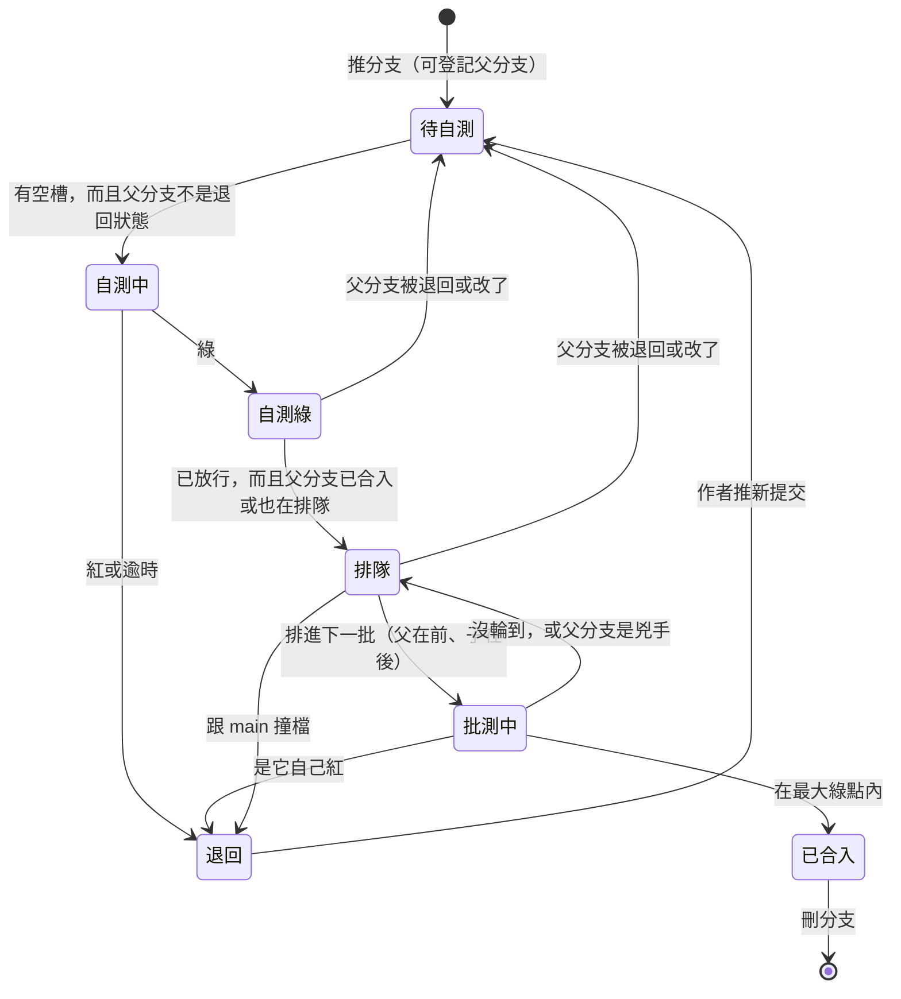

# Relativistic Jet 設計文檔

> 合併佇列加測試調度器。這份是唯一的設計依據，要改行為先改這份。

## 1. 這是什麼

一個**合併佇列加測試調度器**：很多條分支同時想進 `main`，它負責排隊、測試、把測過的合進去。

單機、單一行程、單一 SQLite 檔就能跑。它不認識任何特定專案，專案的差異只靠設定檔和兩個指令接進來。

另附一個**選配的外部元件** `board/`（任務看板，Cloudflare Worker＋D1，JavaScript，用 wrangler 單獨部署）：它是通知的目的地之一，也提供一個給排隊器定時拉取的清單（該管哪些分支、哪些已放行）；看板從不主動連排隊器。核心（`jet/`）不依賴它、不認識它，沒有它排隊器照常運作；看板上卡片中段的狀態一律是排隊器回報的分支狀態。

## 2. 五條原則

1. **Git 只有兩個角色**：程式碼從哪來、合到哪去。不存狀態、結果、待辦或備份。
2. **狀態只在 SQLite**，只有排隊器主行程能寫。
3. **核心不綁專案**。專案的差異只靠一份設定檔和兩個指令（第 5 節）。
4. **`main` 只快轉，而且推上去的那個提交一定完整測過。** 這是唯一不能破的正確性規則。
5. **簡單優先**。沒有量到的數據證明需要，就不加機制。

## 3. 一條分支的一生

沒有父分支的分支，圖裡跟「父分支」有關的條件一律當作成立。

| 狀態 | 意思 | 怎麼離開 |
| --- | --- | --- |
| 待自測 | 剛推上來或剛更新 | 有空槽就開始 |
| 自測中 | 疊在最新 `main` 上跑輕量測試，有時間上限 | 綠、紅、或逾時（逾時算紅） |
| 自測綠 | 自測過了 | 已經有放行就立刻排隊；還沒有就等放行 |
| 排隊 | 自測綠又已放行 | 被排進下一批 |
| 批測中 | 跟同批其他分支疊在一起測 | 合入，或退回 |
| 已合入 | 進了 `main` | 分支自動刪除 |
| 退回 | 自測紅、批測找到是它紅、或跟 `main` 撞檔 | 作者推新提交，回到待自測 |

規則就這幾條：

- **排隊器管哪些分支、誰放行了，有兩種來源，設定檔選一種**：「本機」＝符合命名樣式的分支都管，放行經本機介面或命令列下；「外部來源」＝排隊器定時去一個網址拉一份清單（每筆：分支、父分支、放行到哪個版本），清單裡有的才管，放行也以清單為準。拉不到時沿用上一次成功的清單照常測試與合入，絕不因為拉不到就取消登記或撤回放行。排隊器只往外連，不需要對外開放。
- 自測沒空槽時，分支就停在「待自測」排隊等，不會被丟掉。先看人工設定的優先序，再看誰先推上來。
- 等的時候或跑到一半又推了新提交，只測最新那個：還在等的直接換成新的、位置不變；正在跑的停掉重跑。
- **審查和自測的先後，設定檔選一種**：
  - 「先審後測」：分支推上來先等放行，放行之後才排自測。沒放行的版本不花測試資源。狀態圖裡「待自測→自測中」多一個條件：這個版本已放行。
  - 「不分先後」：一推上來就自測，審查同時進行，兩個都到齊就排隊。
  兩種模式下，放行都是記在「這條分支的這個版本」上；內容變了放行就失效，「先審後測」時連自測也要等重新放行。
  搭配看板（board/）使用時固定用「先審後測」，卡片每個狀態的完整轉移規則見 `docs/CARD_FLOW.md`。
- 排隊器不管誰審、審什麼，它只認「有沒有放行記號」。專案可以在設定檔選：要放行才排隊，或不需要放行（自測綠就直接排隊）。
- 自測沒綠不能進批。
- 分支有新提交就重新自測。內容沒變、只是重新疊到新 `main` 的，放行繼續有效、排隊順位保留。
- 跟 `main` 撞檔就退回；跟同批別的分支撞檔就留到下一批。
- 同一條分支在批測紅兩次就暫停，等人處理。
- 排隊順序：先看人工設定的優先序，再看排隊時間。

### 堆疊分支（一條分支疊在另一條還沒合入的分支上）

批測本來就是把分支一條一條疊起來測，所以堆疊只是多一個「誰要排在誰後面」的限制：

- 分支登記時可以指定一條「父分支」，表示它是接著父分支做的。可以一路疊下去。
- **自測**：疊在 `main` 加整條父鏈上面測。
- **審查**：只看它比父分支多出來的那一段。
- **排隊**：自己自測綠又已放行，而且父分支已合入或也在隊伍裡，才能排隊。組批時父一定排在子前面。
- **父分支合入後**：子分支自動變成普通分支。內容沒變，所以自測和放行都繼續有效。
- **父分支被退回或有新提交**：子分支回到「待自測」，等父分支處理好再測。
- 批測找兇手時，父分支是兇手的話，它的子孫一起留到下一批，不算它們紅。

## 4. 批測怎麼做

1. 從隊伍前面依序取最多 N 條分支（N 是一批的上限，預設 16，設定檔可改），每條分支壓成一個提交，照順序疊在 `main` 上。
2. **同時測四個點**：前 2 條、前 4 條、前 8 條、前 16 條各測一次。
3. 判紅只看「跟 `main` 的基準比，有沒有新的紅項」。`main` 本來就紅的項目不算。
4. **最大的綠點直接快轉進 `main`**。它本身就是完整測過的提交，所以不用再測一次。
5. 如果有紅點：兇手一定在「最大綠點」和「最小紅點」之間那幾條。把那幾條逐條加上去同時測，第一個變紅的就是兇手，退回給作者。其餘的留在隊伍最前面，進下一批。
6. 每個測點有時間上限。**某個測點逾時，就當那個測點紅**，照第 5 步一樣找兇手：讓測試卡死的那條會被找出來退回，不會整批無限重排。只有機器本身出問題（測試根本沒跑起來）才整批重排。

每個測點跑的都是完整的閘門測試，不提早結束、不只跑一部分。

### 合入之後，其他分支怎麼辦

**同一時間只有一批在測**，所以沒有「別的批被作廢」這件事。下一批是合入之後才組的，直接疊在新的 `main` 上。

- **還在排隊的分支**：自測結果繼續有效，不重跑。它們跟新 `main` 合不合得來，交給下一批的批測去驗。
- **排隊中的分支跟新 `main` 撞檔**：合入當下立刻檢查一輪，撞檔的退回給作者，不用等到組批才發現。
- **正在自測的分支**：繼續跑完，不重來。
- **同批沒合入的分支**（排在兇手後面的）：回到隊伍最前面，進下一批。
- **`main` 的基準**：剛合入的那個點本來就完整測過，它的結果直接當新基準，不用另外再測一次 `main`。
- **批測途中 `main` 被別人動了**（例如有人直接推純文件）：如果多出來的全是純文件，就把綠點重新疊上去直接合入，不重測；只要有一個不是純文件，這批作廢重來。這是「推上去的一定是完整測過的提交」唯一的例外。

## 5. 被測專案怎麼接進來

專案只需要提供一份設定檔和兩個指令：

- **測試指令**（必要）：輸入「跑哪一層（自測／閘門／完整）、可以用幾顆核」，輸出每個測試項目的通過或失敗。
- **分類指令**（選配）：輸入「這條分支改了哪些檔」，輸出「純文件，不用測」或「要測」。沒提供就一律要測。純文件的分支放行後直接合入，不進批。

排隊器不知道專案裡有哪些測試、怎麼分層，那是專案自己的事。

## 6. 資源

- 設定檔寫明排隊器可以用哪些核、自測一槽幾核、批測一點幾核。
- **每個測試工作綁自己專屬的核，任何時刻沒有兩個工作共用同一顆核。** 派工前先檢查那些核上沒有別的行程。
- 逾時或取消時，殺掉整個行程群組，不留孤兒。
- 記憶體或磁碟低於設定的水位就暫停派新工作。
- 批測沒在跑的時候，它的核借給自測用。

## 7. 人和代理怎麼跟它講話

排隊器自帶一個查詢介面（HTTP）和同樣功能的命令列：

- **讀**：現況、某條分支的狀態與紅項、已合入清單、待辦、量測數字。附一頁人看的進度頁。
- **寫**：放行／撤回、調優先序、插隊跑一次指定測試、暫停／恢復。

讀和寫各用不同的鑰匙，寫入都留紀錄。預設只在本機開放，要不要對外開由部署的人決定。可選擇讓排隊器自己開通道，並把公開網址登記到固定轉送點；預設關閉。

**通知**：有事情需要人處理（退回、撞檔、暫停、排隊器自己出事）時，攢幾分鐘後一次打到設定好的網址。合入成功預設不逐條通知；可設定多個通知目的地，各自選收哪些事件種類（含自測綠／紅、排隊、合入等狀態變化，給機器用的看板等，例如選配的 `board/`）、各自的權杖與攢批間隔。

## 8. 資料

一個 SQLite 檔，表大致是：分支、放行、測試執行、逐項結果、批次、待辦事件、操作紀錄、`main` 基準。完整的測試輸出存本機檔案，資料庫只記路徑。

每小時本機備份一份。資料庫壞了就還原備份，再重新掃一次 Git 上的分支；備份之後才放行的分支，放行記號作廢、重新確認。寧可重審，不可誤合。

## 9. 排隊器自己不能掛

- 設定檔載入前先檢查格式，壞的不載、沿用舊的。
- 換新版後短時間內連續當掉三次，自動退回上一版。
- 排隊器的程式不經過它自己管的那條隊伍，所以它壞了可以直接修。

## 10. 明確不做（有數據再說）

多車道並行、只跑受影響的測試、樂觀預測下一批、自動調整批量、共用資料檔自動合併、已知失敗清單。

每一項都是「現在量不到它值多少」。第一版上線量一週，哪裡真的慢再加哪個。

## 11. 里程碑與驗收

**M0 最小可用版**：第 3 到 9 節全部，通知除外。

驗收：

1. 拿庫內附的小範例專案（合成測試），不改核心就能跑完「自測、批測、合入」。
2. 故意放兩條會紅的分支進同一批，兩條都被找出來退回，其他照常合入。
3. `main` 本身有紅項時，沒有新紅的分支照常合入。
4. 任何時刻沒有兩個測試共用同一顆核。
5. 整個過程排隊器對被測專案只做兩種寫入：快轉 `main`、刪已合入的分支。
6. 砍掉資料庫再啟動，能從備份恢復，沒有誤合。

**M1**：通知、分類指令。

**之後**：看實際量到的數字決定。

## 12. 發布前再決定

授權條款、程式與說明文件用什麼語言、對外名稱。
